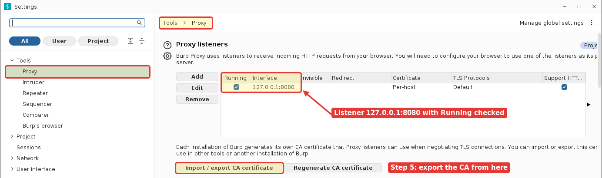
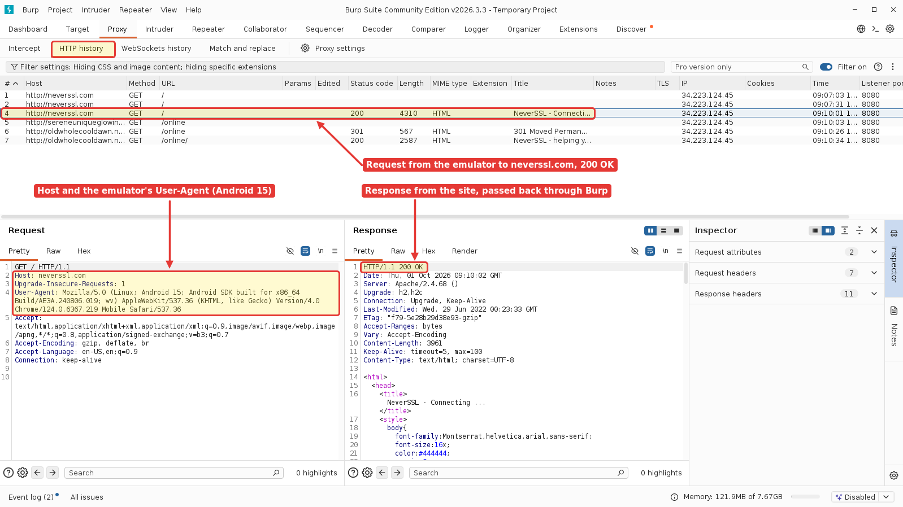
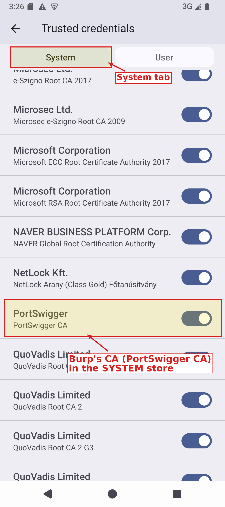

# Import Burp's Certificate to the System Trust Store

In this lab, you will install Burp Suite, connect an Android emulator to its proxy, and add Burp's certificate to Android's **system trust store**. You will then view decrypted HTTPS traffic from the emulator's browser. All setup is included below; you can begin with a fresh course VM.

## Before You Start

Use the **Ubuntu x86_64 VM supplied for this course**. Its base image provides the Android SDK at `~/Android/Sdk`, ADB, and the **Pixel_9 emulator running Android 15 / API 35** with a root-capable AOSP image and WebView Browser Tester. You also need internet access and permission to run `sudo`.

The steps below install Burp and the additional Ubuntu tools used in this lab. Run Ubuntu commands in the VM's Terminal, rather than on your own computer.

> [!IMPORTANT]
> This lab requires **`adb root`**. Use the supplied course emulator; Google Play system images do not allow this root access. Android 15 reads system certificates from `/apex/com.android.conscrypt/cacerts`, so we will create a temporary overlay for that store.

## Step 1: Install and Start Burp Suite

Open a Terminal in Ubuntu. Run each command and wait for it to finish:

```bash
sudo apt update
sudo apt install -y curl ca-certificates openssl file
```

`curl` downloads the installer, `ca-certificates` supports secure downloads, `file` checks the downloaded file type, and `openssl` converts and inspects certificates.

Create a working folder and download **Burp Suite Community Edition**:

```bash
mkdir -p "$HOME/Desktop/Labs/SystemTrust"
cd "$HOME/Desktop/Labs/SystemTrust"
curl --fail --location --output burp.sh "https://portswigger.net/burp/releases/download?product=community&type=Linux"
file burp.sh
```

The last command should identify a **shell script**, not an HTML page. Start the installer:

```bash
chmod +x burp.sh
./burp.sh
```

In the installation window, click **Next**, keep the default installation folder and shortcuts, and finish the installation. Open Ubuntu's application menu, search for **Burp Suite Community Edition**, and launch it.

In Burp's startup windows:

1. Read and accept the terms if prompted.
2. Select **Temporary project in memory**, then **Next**.
3. Select **Use Burp defaults**, then **Start Burp**.

**Keep Burp open for the rest of the lab.** The proxy receives traffic only while Burp is running.

## Step 2: Start Android and Connect ADB

Close any running Android emulator. In a **second Ubuntu terminal**, start the supplied Pixel_9:

```bash
cd ~/Android/Sdk/emulator
./emulator -avd Pixel_9 -port 5554 -writable-system -no-snapshot
```

This starts the emulator with a writable system image and disables loading or saving Quick Boot snapshots. Leave this terminal open and wait until Android's home screen appears.

Return to your **first Ubuntu terminal**. Use this terminal for the remaining commands:

```bash
export PATH="$HOME/Android/Sdk/platform-tools:$PATH"
adb devices
```

Look for **`emulator-5554`** with the status **`device`**. The `-port 5554` option above fixes this emulator's serial, so every device command below selects it explicitly.

Restart ADB on the emulator with root privileges and check the Android version:

```bash
adb -s emulator-5554 root
adb -s emulator-5554 wait-for-device
adb -s emulator-5554 shell id
adb -s emulator-5554 shell getprop ro.build.version.sdk
adb -s emulator-5554 shell getprop ro.build.version.release
```

The results should include **`uid=0(root)`**, **`35`**, and **`15`**. If root is refused, stop here: the emulator is not using the required course image.

## Step 3: Configure and Check the Proxy

In Burp, open **Proxy → Proxy settings**. Under **Proxy listeners**, confirm that **`127.0.0.1:8080`** has **Running** checked. If the listener is missing, click **Add**, set **Bind to port** to `8080` and **Bind to address** to **Loopback only**, then click **OK**.



Close the settings window. Open **Proxy → Intercept** and make sure the button says **Intercept is off**. This lets requests continue without waiting for you to forward them manually.

In your first Ubuntu terminal, point Android at Burp:

```bash
adb -s emulator-5554 shell settings put global http_proxy 10.0.2.2:8080
adb -s emulator-5554 shell settings get global http_proxy
```

The output should be **`10.0.2.2:8080`**. Inside the Android emulator, `10.0.2.2` reaches the Ubuntu VM's localhost, where Burp is listening.

## Step 4: Check That HTTP Traffic Reaches Burp

Check the connection with a plain HTTP page:

```bash
adb -s emulator-5554 shell am start -a android.intent.action.VIEW -d http://neverssl.com -p org.chromium.webview_shell
```

If Android asks which app to use, choose **WebView Browser Tester**. If the address appears without loading, press the **>** button beside it.

In Burp, open **Proxy → HTTP history**. Select a request to `neverssl.com` and look at its request and response. This confirms that Android is sending traffic through Burp before we change certificate trust.



If no request appears, check the listener's **Running** box, the proxy value above, and that **Intercept is off** before continuing.

## Step 5: Export This Burp Installation's Certificate

Burp uses its own certificate authority (CA) to inspect HTTPS. Android must trust the certificate from the **Burp installation you are using now**.

In your Ubuntu terminal, print the exact location where you will save it:

```bash
printf '%s\n' "$HOME/BurpCA.der"
```

For the course account, this is normally **`/home/ubuntu/BurpCA.der`**. Use the full path printed by your terminal in the following dialog.

1. In Burp, open **Proxy → Proxy settings**.
2. Under **Proxy listeners**, click **Import / export CA certificate**.
3. Under **Export**, select **Certificate in DER format**, then **Next**.
4. Enter the full path printed above, including **`BurpCA.der`**. Confirm replacement if that file already exists.
5. Click **Next**, then **Close** after the export succeeds.

<!-- AUTHOR SCREENSHOT — Show the certificate export dialog with "Certificate in DER format" selected, followed by the full BurpCA.der output path. Place the screenshots here. -->

Confirm that the exported file exists and can be read:

```bash
ls -l "$HOME/BurpCA.der"
openssl x509 -inform DER -in "$HOME/BurpCA.der" -noout -subject -issuer
```

The certificate details should identify **PortSwigger**. We will install this certificate directly into the system store; installing it into the user store is not a prerequisite.

## Step 6: Prepare the Certificate

Android names each system CA file after a hash of its subject, followed by `.0`. Convert the DER certificate to PEM, calculate that hash, and copy the certificate to Android:

```bash
openssl x509 -inform DER -in "$HOME/BurpCA.der" -out "$HOME/BurpCA.pem"
HASH=$(openssl x509 -inform PEM -subject_hash_old -noout -in "$HOME/BurpCA.pem")
echo "Certificate filename: ${HASH}.0"
cp "$HOME/BurpCA.pem" "$HOME/${HASH}.0"
adb -s emulator-5554 push "$HOME/${HASH}.0" "/data/local/tmp/${HASH}.0"
```

**Keep the hash shown in your terminal visible.** It is specific to your certificate, so it may differ from the examples and screenshots.

## Step 7: Overlay the System Trust Store

We will copy Android's existing CA certificates into a temporary, writable store, add Burp's CA, and make Android's app processes use that store.

> [!WARNING]
> **Keep the emulator running after this step.** The certificate overlay is temporary. A reboot or closing this emulator session removes it. After restarting Android with the Step 2 command, repeat Steps 6–8 before testing HTTPS again.

Open a root shell **inside Android**:

```bash
adb -s emulator-5554 shell
```

The prompt should end in **`#`**. All commands in this step, until `exit`, run inside Android.

1. Set `HASH` in this device shell. **Replace `9a5ba575` below with your own hash from Step 6**, without the `.0` extension:

```bash
HASH=9a5ba575
ls -l "/data/local/tmp/${HASH}.0"
```

The `ls` command should show the certificate you pushed. If it says the file does not exist, correct `HASH` before continuing.

2. Record the original certificate count and copy the certificates from the read-only APEX store:

```bash
BEFORE=$(ls /apex/com.android.conscrypt/cacerts | wc -l)
echo "Original certificate count: $BEFORE"
mkdir -p -m 755 /data/local/tmp/ca-copy
cp /apex/com.android.conscrypt/cacerts/* /data/local/tmp/ca-copy/
```

3. Mount an empty in-memory filesystem over the old system CA folder. Fill it with the existing certificates and Burp's certificate:

```bash
mount -t tmpfs tmpfs /system/etc/security/cacerts
cp /data/local/tmp/ca-copy/* /system/etc/security/cacerts/
cp "/data/local/tmp/${HASH}.0" /system/etc/security/cacerts/
```

4. Set the ownership, permissions, and SELinux label expected for system certificates:

```bash
chown root:root /system/etc/security/cacerts/*
chmod 644 /system/etc/security/cacerts/*
chcon u:object_r:system_security_cacerts_file:s0 /system/etc/security/cacerts/*
```

5. Bind the new store over the APEX certificate folder for this shell:

```bash
mount --bind /system/etc/security/cacerts /apex/com.android.conscrypt/cacerts
```

6. Apply the same bind inside **Zygote**, the process Android uses to start apps. Paste the complete block:

```bash
for z in $(pidof zygote) $(pidof zygote64); do
  nsenter --mount=/proc/$z/ns/mnt -- \
    mount --bind /system/etc/security/cacerts /apex/com.android.conscrypt/cacerts
done
```

Apps started from these Zygote processes after the change can use the new store. The commands above normally produce no output. If any command reports an error, stop at that command before proceeding.

7. Check the count, then leave the Android shell:

```bash
echo "Before: $BEFORE"
echo "After: $(ls /apex/com.android.conscrypt/cacerts | wc -l)"
exit
```

On a fresh emulator, the second count should be **one higher**. The starting count varies with the system image.

You are now back in Ubuntu. Check the certificate and the Zygote mount:

```bash
adb -s emulator-5554 shell ls -lZ "/apex/com.android.conscrypt/cacerts/${HASH}.0"
adb -s emulator-5554 shell 'grep cacerts /proc/$(pidof zygote64)/mountinfo'
```

The first command should show your file with **`-rw-r--r--`**, owner **`root root`**, and label **`u:object_r:system_security_cacerts_file:s0`**. The second should include a mount at **`/apex/com.android.conscrypt/cacerts`** backed by **`tmpfs`**.

## Step 8: Verify the Certificate in Android Settings

Settings and its certificate service may have started before the overlay. Restart them from the Ubuntu terminal:

```bash
adb -s emulator-5554 shell am force-stop com.android.settings
adb -s emulator-5554 shell am force-stop com.android.keychain
```

On Android, open **Settings → Security & privacy → More security & privacy → Encryption & credentials → Trusted credentials**. Select the **System** tab and scroll to **PortSwigger / PortSwigger CA**.

**Encryption & credentials** is near the bottom of the More security & privacy page. You can also search Android Settings for **trusted credentials**.



Confirm that the certificate is on the **System** tab before proceeding.

## Step 9: View Decrypted HTTPS Traffic

Restart **WebView Browser Tester** so it starts after the certificate overlay. In your Ubuntu terminal, run:

```bash
adb -s emulator-5554 shell am force-stop org.chromium.webview_shell
adb -s emulator-5554 shell am start -a android.intent.action.VIEW -d https://www.google.com -p org.chromium.webview_shell
```

Use the browser **inside the Android emulator**. Its icon is the small Android robot:


If necessary, enter **`https://www.google.com`** in its address bar and press **>** to load the page. The page should open without a certificate warning.


Return to Burp's **Proxy → HTTP history**. Find a request to **`www.google.com`**, select it, and inspect the **Request** and **Response** panes. You should be able to read the HTTP headers and response content carried over HTTPS.


You have now installed Burp's CA in the system trust store and used it to inspect the browser's HTTPS traffic. Apps with certificate pinning or their own trust rules may still reject Burp's certificates.
